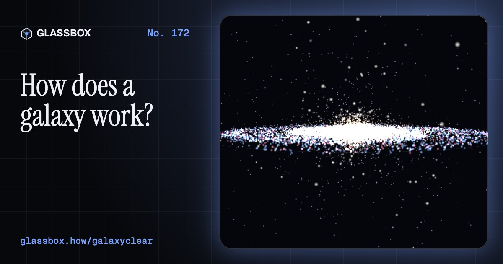
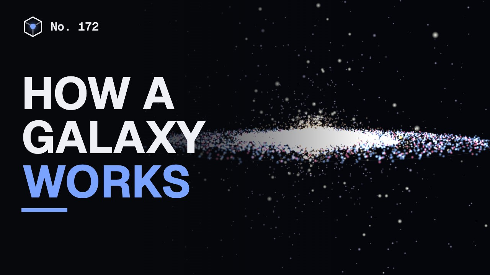
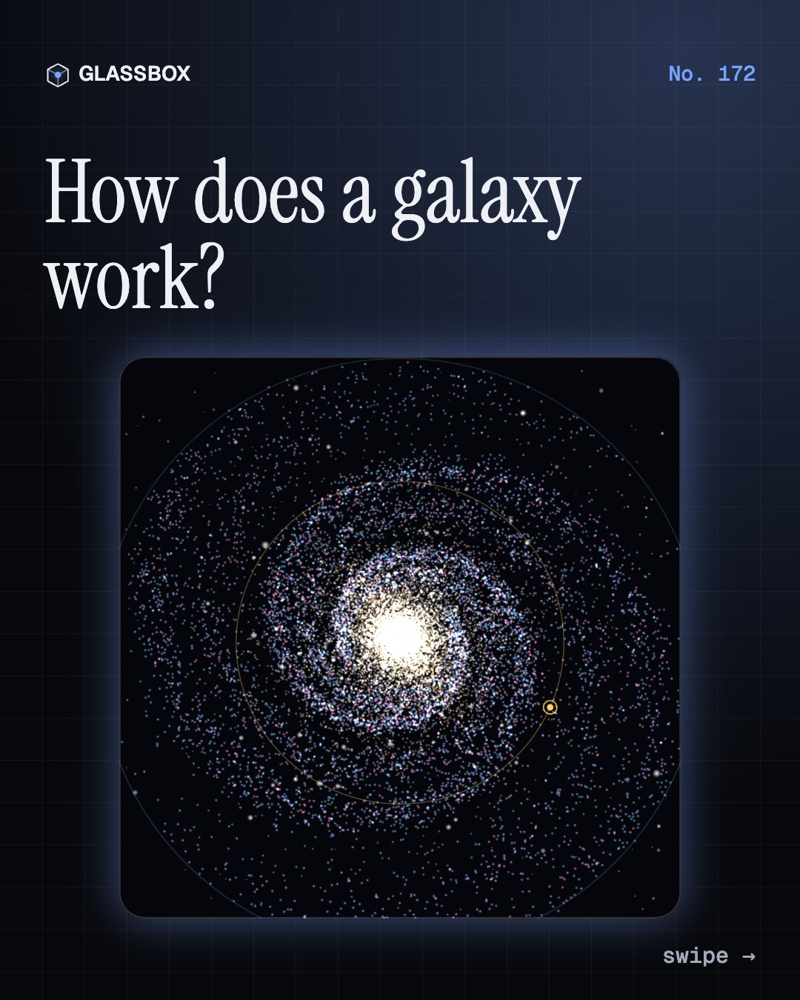
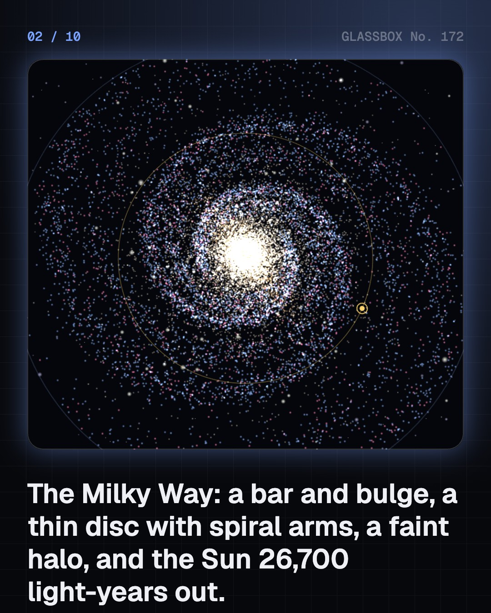
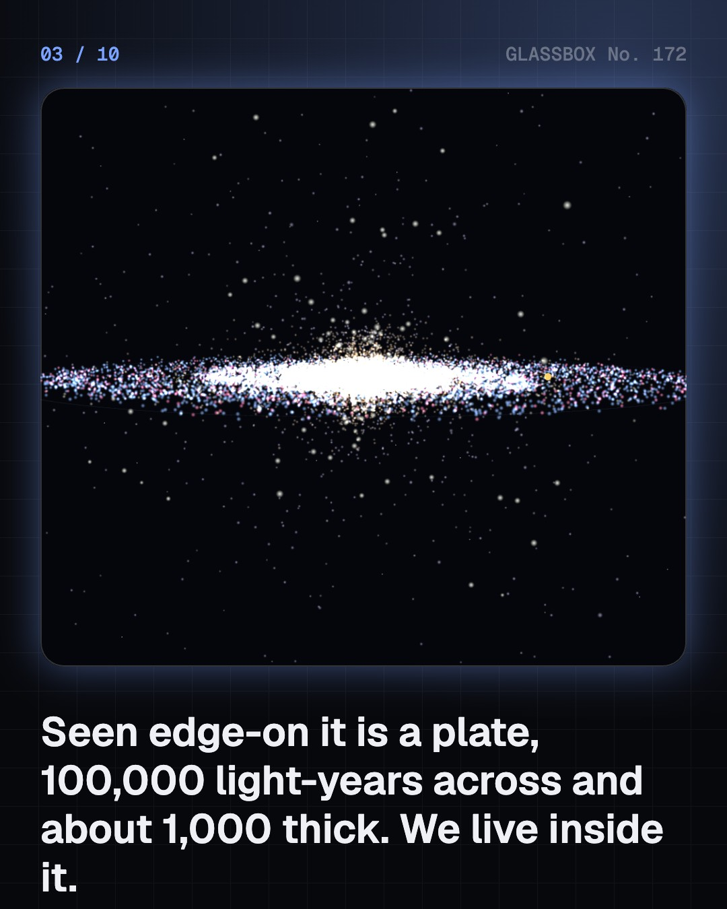
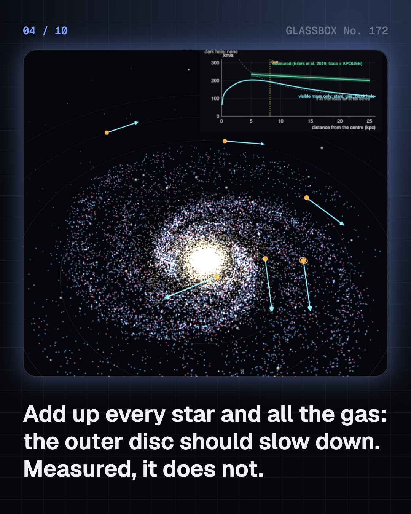

<!-- glassbox:start -->
<!-- Generated from glassbox.json by the Glassbox hub (npm run readme -- galaxyclear). Edit glassbox.json, not this block. -->
<p align="center"><a href="https://glassbox.how/e/galaxyclear/"></a></p>

<h1 align="center">GalaxyClear</h1>

<p align="center"><b>How does a galaxy work?</b><br>A few hundred billion stars going round a black hole, held by gravity we can add up and by five times more that we cannot see. Stand at the Sun and watch the Milky Way vanish under city lights, add dark matter until the rotation curve fits, wind up the spiral arms, and crash two galaxies together.</p>

<p align="center"><a href="https://glassbox.how/galaxyclear/"><b>▶ Play with it</b></a> &nbsp;·&nbsp; <a href="https://glassbox.how/e/galaxyclear/">Read the 60-second explainer</a> &nbsp;·&nbsp; <a href="https://glassbox.how/galaxyclear/glassbox/reel.mp4">Watch the 40-second video</a></p>

<p align="center">
  <a href="https://glassbox.how/e/galaxyclear/"></a>
  <a href="https://glassbox.how/e/galaxyclear/"></a>
  <a href="LICENSE"></a>
  <a href="LICENSE-CONTENT.md"></a>
  <a href="#privacy"></a>
</p>

## In 60 seconds

1. **A plate of stars with a bar in the middle.** The Milky Way is a disc about 100,000 light-years across and about 1,000 thick, with a bar and bulge of old yellow stars at the centre, spiral arms of young blue stars and pink nebulae, a faint thick disc, and a sparse halo with about 150 globular clusters. At the very centre sits Sagittarius A*, a black hole of about 4 million solar masses. The Sun is 26,700 light-years out, on the Orion Spur, so we see the disc edge-on as a band across the night sky: Akash Ganga, the Ganges of the sky.
2. **The outer stars should slow down. They don't..** Add up every star, all the gas and the black hole, and the pull on the outer disc is too weak: the speed should fall like Neptune's does. Measured, the Milky Way turns at 229 km/s at the Sun and still about 200 km/s at 25 kpc. The usual answer is a dark-matter halo of about a trillion solar masses, inferred from gravity and never yet identified. A minority of physicists prefer a change to gravity itself.
3. **Spiral arms are traffic jams.** Inner stars lap the Galaxy far more often than outer ones, so arms made of fixed stars would wind up tight within a few hundred million years. Real arms are density waves: a slow-turning crowding of oval orbits that stars and gas pass through. Gas is squeezed on the way in and bursts into new stars, which is why arms glow blue and pink.
4. **Spirals, ellipticals, irregulars, and crashes.** Hubble's tuning fork sorts galaxies by shape, ellipticals on the handle and spirals and barred spirals on the prongs. It is a catalogue, not a life story. When two discs collide, the stars miss each other, gravity throws out tidal tails, and the pair settles into one elliptical blob. Andromeda is coming our way: NASA's 2012 model says a meeting in about 4 billion years; a 2025 study gives close to even odds of no merger at all in 10 billion.
5. **Gas to stars to dust to gas.** The Milky Way turns about 1.65 Suns' worth of gas into stars every year and hosts about two supernovae a century. Dying stars give the gas back enriched with carbon, oxygen and iron, so every generation of stars, and every one of us, is made of star stuff. Jets and winds from the black hole and from supernovae heat and expel gas, slowing the cycle. The Sun takes about 220 million years for one lap.
6. **A ladder of distances, and a count.** Parallax fixes the nearby stars, Leavitt's Cepheids reach the nearest galaxies, and Hubble's law, speed proportional to distance, reaches across the expanding universe. The Milky Way sits in the Local Group of over 50 galaxies, near the Virgo cluster. Counts from Hubble's deep fields give 100 to 200 billion galaxies in the observable universe, or about 2 trillion once the faint ones are included.

## Words worth knowing

| Term | Meaning |
|---|---|
| **Galaxy** | Billions of stars, with gas, dust and dark matter, held together by gravity and orbiting a common centre. |
| **Rotation curve** | A graph of orbital speed against distance from a galaxy's centre. Spirals have flat ones, which is the evidence for dark matter. |
| **Dark matter** | Unseen mass inferred from gravity. It seems to outweigh the stars in a galaxy about five to one, and nobody yet knows what it is. |
| **Density wave** | A spiral-shaped crowding of orbits that turns slowly as a pattern while stars and gas sweep through it: the standard picture of spiral arms. |
| **Sagittarius A*** | The black hole at the centre of the Milky Way, about 4 million solar masses, pictured by the Event Horizon Telescope on 12 May 2022. |
| **Tuning fork** | Hubble's diagram sorting galaxies by shape: ellipticals E0–E7, lenticulars, then spirals and barred spirals on two prongs. |
| **Cepheid** | A pulsing giant star whose period tells its true brightness (Leavitt, 1912), so it can be used to measure distance. |
| **Hubble's law** | Galaxies recede at a speed proportional to their distance: v = H₀ × d. The universe is expanding. |
| **Local Group** | Our neighbourhood of over 50 galaxies, about 10 million light-years across, led by Andromeda and the Milky Way. |

## A short history

**From a river of milk across the night to a photograph of the black hole at its heart.**

- **450 BCE** · A road of faint stars? (Democritus and Anaxagoras, Abdera and Athens, Greece)
- **1610** · Galileo turns the band into stars (Galileo Galilei, Padua and Venice, Italy)
- **1912** · Leavitt's law (Henrietta Swan Leavitt, Harvard College Observatory, Cambridge, USA)
- **1923** · A Cepheid in Andromeda (Edwin Hubble, Mount Wilson Observatory, California, USA)
- **1927** · The Galaxy rotates (Jan Oort, after Bertil Lindblad, Leiden, Netherlands)
- **1929** · Farther means faster (Edwin Hubble, Mount Wilson Observatory, California, USA)
- **1964** · Arms as density waves (C. C. Lin and Frank Shu, Massachusetts Institute of Technology, USA)
- **1970** · Andromeda will not slow down (Vera Rubin and Kent Ford, Carnegie Institution, Washington, D.C., USA)

The full story, with 32 moments, charts, people and 54 sources: [glassbox.how/e/galaxyclear/history](https://glassbox.how/e/galaxyclear/history/). The data lives in [`history.json`](history.json).

## Video and slides

Made with the Glassbox studio from this box's storyboard (`window.glassbox.director`). Free to reuse under CC BY 4.0.

<a href="https://glassbox.how/galaxyclear/glassbox/video.mp4"></a>

<p><a href="glassbox/slide-1.jpg"></a> <a href="glassbox/slide-2.jpg"></a> <a href="glassbox/slide-3.jpg"></a> <a href="glassbox/slide-4.jpg"></a></p>

| File | What | Size |
|---|---|---|
| [`glassbox/reel.mp4`](https://glassbox.how/galaxyclear/glassbox/reel.mp4) | Reel / Short, with captions and soundtrack | 1080×1920 |
| [`glassbox/video.mp4`](https://glassbox.how/galaxyclear/glassbox/video.mp4) | YouTube video, with captions and soundtrack | 1920×1080 |
| `glassbox/slide-1…10.jpg` | Instagram carousel | 1080×1350 |
| `glassbox/thumb.jpg` | YouTube thumbnail | 1280×720 |
| `glassbox/cover.jpg` | Share card and repo social preview | 1200×630 |
| [`glassbox/history-reel.mp4`](https://glassbox.how/galaxyclear/glassbox/history-reel.mp4) | “History in 10 moments” Reel / Short | 1080×1920 |
| `glassbox/history-slide-*.jpg` | History carousel | 1080×1350 |
| `glassbox/post.json` | Post copy and schedule used by the publish kit | |

## Privacy

This box has no accounts and no ads, and it ships its own fonts and libraries. When you run it yourself it sends nothing anywhere. On glassbox.how, the site's `/bar.js` also loads Glassbox's analytics: **Google Analytics** to count visits (it asks first in the EU, UK and Switzerland, and stays off when your browser sends Global Privacy Control or Do Not Track) and **ClickTrust** to detect bots.

It remembers a few things **in your own browser only**, and never sends them anywhere:

| Browser storage key | What it holds |
|---|---|
| `galaxyclear.v1` | Which chapters you have opened, your best quiz scores, and sound on or off. |

Exactly what each one sees is at [glassbox.how/privacy](https://glassbox.how/privacy/).

## Licences

- **Code:** [MIT](LICENSE). Use it, change it, ship it.
- **Explanations, text, images and videos** (`glassbox.json`, `glassbox/`): [CC BY 4.0](LICENSE-CONTENT.md). Credit “Glassbox, glassbox.how/e/galaxyclear”.
- **Third-party parts** keep their own licences: [three.js](https://threejs.org) (MIT), [Geist, Instrument Serif](https://openfontlicense.org) (SIL OFL 1.1).
- The Glassbox name and logo aren't covered by either licence. See the [terms](https://glassbox.how/terms/).

Found a mistake? [Open an issue](https://github.com/bdeeps/galaxyclear/issues). Corrections happen in public.
<!-- glassbox:end -->

## Run it

It's plain HTML, CSS and JavaScript. No build step and no dependencies. Run locally, it contacts no other website.

```bash
python3 -m http.server 8000
```

Three.js and the fonts ship in `vendor/` and `fonts/`, so it also works offline.

Then open http://localhost:8000.

## How it's built

| File | What |
|---|---|
| `index.html`, `css/app.css` | The page and its styles |
| `js/app.js`, `js/stage.js`, `js/ui.js`, `js/kit.js` | The shared Glassbox 3D engine: chapters, 3D stage, controls, quiz, video director |
| `js/chapters/*.js` | One file per chapter: the 3D model, controls, text, key terms, quiz and video scenes |
| `js/galaxy.js` | GalaxyClear's own parts: the Milky Way's mass model and rotation curve (with sources), the particle galaxy, chart boards, layout helpers |
| `glassbox.json` | Title, question, explainer beats, key terms, browser storage and credits shown on glassbox.how |
| `reel` in each chapter | The storyboard the Glassbox studio records into short videos |
| `glassbox/` | The published video, slides, thumbnail and post copy |
| `fonts/`, `vendor/three/` | Self-hosted Geist and Instrument Serif (SIL OFL 1.1) and three.js (MIT) |
